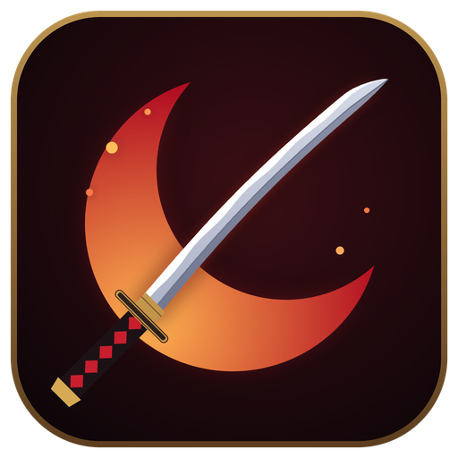

<p align="center"></p>

# Tenseiga

A from-scratch client for rAthena servers (formerly roclient), in Rust (wgpu: Vulkan / DX12 / GL).

Status: login → character select → map entry → stay connected (headless). Rendering is a
window that clears; map and sprite loading come next.

## Target

PACKETVER **20250402** (main), the newest rAthena supports. The server must be built to match.
Add these lines to rAthena's `src/custom/defines_pre.hpp`:

```cpp
#define PACKETVER 20250402
#undef PACKET_OBFUSCATION   // not implemented in the client yet
```

and set `pincode_enabled: no` in `conf/char_athena.conf`.

## Crates

| crate | role |
|---|---|
| `ro-proto` | framing codec, packet encode/parse, generated packet table |
| `ro-net` | login / char / map connection state machines |
| `ro-vfs` | GRF 0x200 + loose `data/` folder |
| `ro-render` | wgpu renderer |
| `ro-client` | the client binary, `tenseiga` |
| `tools/packetgen` | regenerates `ro-proto/src/generated.rs` from rAthena |
| `tools/grfdump` | list / extract GRF contents |

## Run

```
copy config\example.toml config\local.toml    # edit account
cargo run -p ro-client -- --headless          # protocol smoke test
cargo run -p ro-client                        # window
```

`RUST_LOG=debug` shows every packet that was skipped.

## Packet table

`crates/ro-proto/src/generated.rs` is checked in. To regenerate it for another rAthena revision
or PACKETVER (requires Visual Studio with the C++ workload):

```
cargo run -p packetgen -- ..\rathena 20250402
```

packetgen compiles a small program against rAthena's real headers (`map/packets.hpp`,
`common/packets.hpp`, `clif_packetdb.hpp`, `clif_shuffle.hpp`) with MSVC. That way every
length, opcode and field offset is the one the server itself uses, with no re-implemented
`#if PACKETVER` logic. Client packets are encoded from the handler's most recent
registration (`client_packet("WalkToXY")`), so shuffled opcodes follow the table.

## Custom items and quests

The server's databases (`db/import/item_db.yml`, `quest_db.yml`) decide what an item or
quest does; the client's data files only give it a name, icon and description. Like the
original client, Tenseiga reads the stock compiled tables and then, from the client
folder, any plain-text Lua with the same layout, whose entries override the stock ones:

| What | Stock (compiled) | Text overrides, read in this order |
|---|---|---|
| Items | `System/iteminfo.lub` | `System/itemInfo.lua`, `System/iteminfo_custom.lua` |
| Quests | `System/OngoingQuestInfoList_True.lub` | `System/OngoingQuestInfoList_True.lua`, `System/questinfo_custom.lua` |

Write them in CP949 (EUC-KR), like the originals:

```lua
tbl = {
	[990001] = {
		unidentifiedDisplayName = [=[Dagger]=],
		unidentifiedResourceName = [=[나이프]=],   -- icon/sprite name under data\texture\...\item\
		unidentifiedDescriptionName = { [=[An unknown item.]=] },
		identifiedDisplayName = [=[Custom Test Blade]=],
		identifiedResourceName = [=[나이프]=],
		identifiedDescriptionName = { [=[A blade added by this server.]=] },
		slotCount = 2,
		ClassNum = 1,                                -- weapon/headgear view
	},
}

QuestInfoList = {
	[990100] = { Title = "Client Test Hunt", Summary = "Hunt 3 Porings", Description = { "..." } },
}
```

An item or quest the client has no entry for still works; it shows as `Item #id` /
`Quest id` with no icon.

## License

MIT, see [LICENSE](LICENSE). Code ported from other projects keeps its own notice in
[THIRD_PARTY_NOTICES.md](THIRD_PARTY_NOTICES.md). The licence covers this code only: Ragnarok
Online game data (GRFs, texture packs built from them) belongs to Gravity and is not included.
